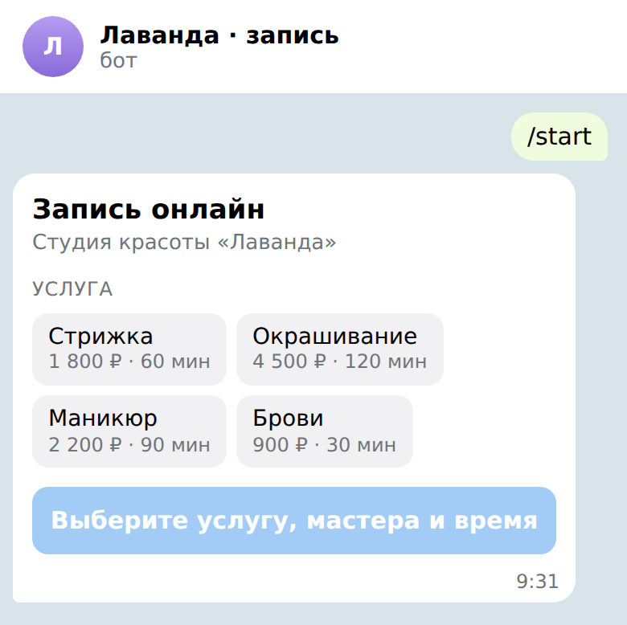
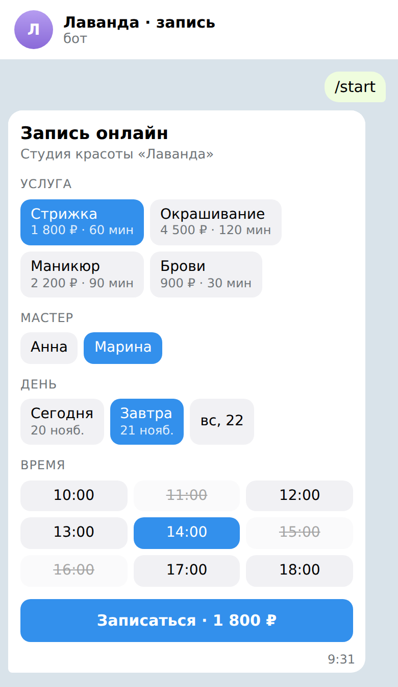
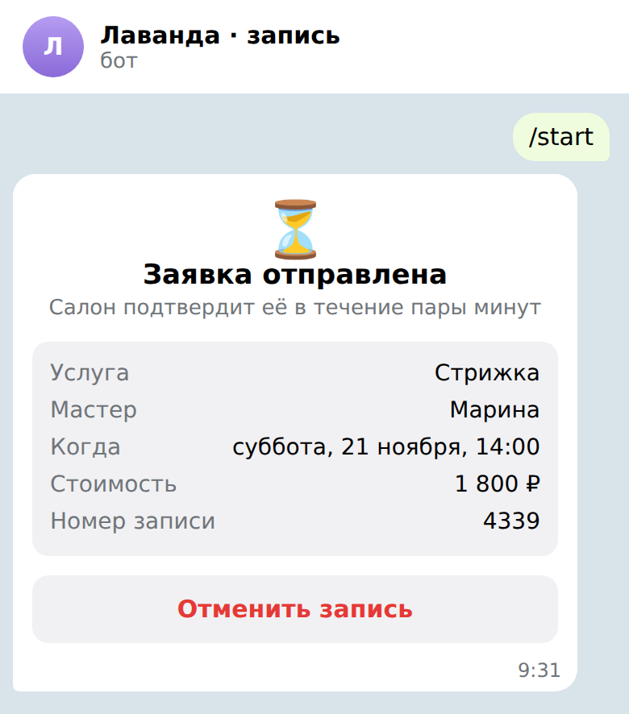
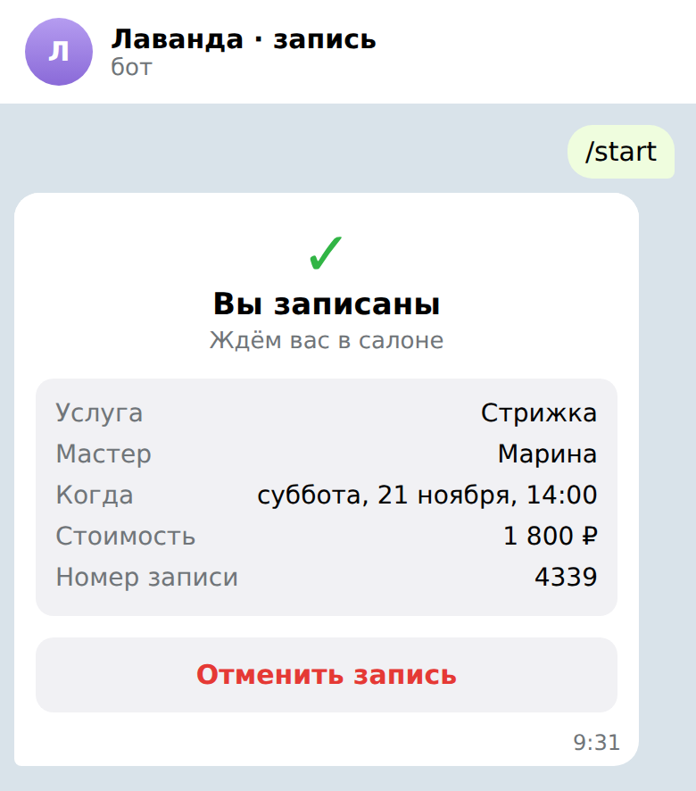

# Бот записи с виджетом прямо в сообщении Telegram

Клиент пишет боту /start и получает одно сообщение, в котором можно сразу
записаться: выбрать услугу, мастера, день и время и нажать «Записаться».
Mini App и браузер не открываются. Дальше это же сообщение показывает статус:
«Заявка отправлена», а после подтверждения салона — «Вы записаны».
Отменить запись можно там же.

Построено на виджетах в сообщениях из Bot API 10.4 (Telegram, 09.11.2026).

> Это демо: студия «Лаванда», мастера и записи выдуманы.

> **Статус демо.** Логика бота, запросы виджета и пределы Telegram проверены
> тестами и сценарием в браузере. В живом приложении Telegram демо ещё не
> проверялось, снимки ниже сняты в браузере с подменой Telegram.
> Принимает ли Telegram этот виджет на деле, не подтверждено.

## Как выглядит

| Выбор | Время выбрано | Заявка | Подтверждено |
|---|---|---|---|
|  |  |  |  |

Виджет берёт цвета чата, поэтому в тёмной теме выглядит так:
[выбор](docs/screens/2-vybor-dark.png), [заявка](docs/screens/3-zayavka-dark.png),
[подтверждено](docs/screens/4-zapisan-dark.png).

Снимки — макет, а не снимки из Telegram: виджет запущен в браузере
(Chromium) внутри макета чата, Telegram подменён заглушкой, а запросы виджета
обрабатывает настоящая логика бота. Приложение Telegram рисует виджет своим
движком, поэтому шрифт и отступы там будут отличаться.

## Что умеет

**Клиенту**
- в одном сообщении: услуга с ценой и длительностью, мастера, которые её
  делают, три ближайших дня, сетка времени;
- занятое и прошедшее время зачёркнуто; записаться можно не позже чем за час;
- пока сообщение открыто, бот раз в 30 секунд обновляет занятое время. Если
  кто-то успел записаться раньше, виджет так и скажет и обновит сетку;
- статус заявки меняется в том же сообщении: салон подтвердил или отклонил,
  клиент отменил;
- светлая и тёмная тема: виджет берёт цвета чата.

**Салону**
- каждая заявка приходит в чат администратора с кнопками «Подтвердить» и
  «Отклонить», и клиент сразу видит ответ в своём сообщении;
- без чата администратора демо подтверждает заявку само через 3 секунды;
- услуги, мастера и часы работы задаются в `data/catalog.json`, код не трогаем.

## Как устроено

Виджет — это небольшая HTML-страница внутри сообщения. Telegram запускает её
на телефоне клиента без доступа в интернет, и общаться она может только
с ботом, короткими запросами до 64 байт:

| Запрос | Что делает бот |
|---|---|
| `r` | присылает свежую сетку занятого времени |
| `b:<услуга>:<мастер>:<ММДД>:<ЧЧММ>` | проверяет время, создаёт заявку, уведомляет салон |
| `x` | отменяет запись клиента |

Бот сразу отвечает на запрос (`answerWidgetQuery`), а статус кладёт
в состояние сообщения (`editMessageWidgetData`). Виджет перерисовывается сам,
новое сообщение не нужно. Каждый запрос бот сверяет со своими записями:
от виджета берётся только выбор, а свободно ли время и чья это запись, проверяет сервер.

Методы виджетов вызываются прямыми запросами к Bot API (`widget_bot/api.py`):
библиотеки для ботов их ещё не поддерживают.

Пределы Telegram из документации проверяются тестами: HTML до 32 КБ и до
4096 байт в сжатом виде (у этого виджета ~3,1 КБ), состояние до 1 КБ даже
при полностью занятой сетке. Это сверка с документацией: настоящий Telegram
виджет пока не принимал. Ещё один тест следит, чтобы в шаблоне не было того, что Telegram
вырезает из виджетов: полей ввода, внешних скриптов, сетевых запросов.

## Ограничения Telegram сейчас

- Виджеты работают только в личном чате с ботом. В группах, инлайн-режиме
  и пересылках они пока есть только на тестовом сервере Telegram.
- Переслать сообщение с виджетом нельзя.
- В виджете нет полей ввода. Имя клиента бот берёт из профиля Telegram, а если
  нужен телефон, его можно попросить кнопкой «Поделиться номером».
- Старые версии приложений показывают вместо виджета «неподдерживаемое
  сообщение».

## Запуск

```bash
python -m venv .venv && .venv/bin/pip install -r requirements.txt
cp .env.example .env   # BOT_TOKEN от @BotFather, ADMIN_CHAT_ID — чат салона
.venv/bin/python -m widget_bot
```

Записи хранятся в `data/bookings.json` — это хранилище для демо, в работе его заменит база данных.

Проверка:

```bash
.venv/bin/pip install -r requirements-dev.txt && .venv/bin/playwright install chromium
.venv/bin/pytest -q                 # логика, пределы Telegram, бот на подменном Bot API
.venv/bin/python tools/shoot.py     # сценарий в браузере и снимки в docs/screens
```
